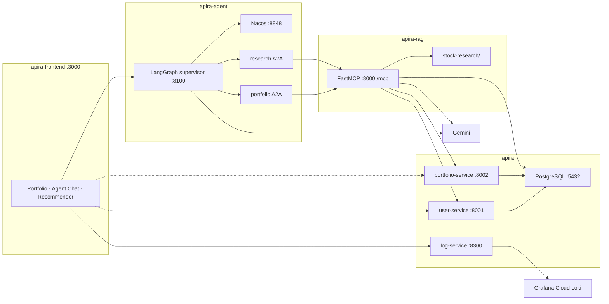

# Apira

[](https://www.python.org/)
[](https://fastapi.tiangolo.com/)
[](https://langchain-ai.github.io/langgraph/)
[](https://modelcontextprotocol.io/)
[](https://ai.google.dev/)
[](https://docs.docker.com/compose/)

**Multi-agent portfolio assistant** on one machine: login and holdings over REST, then a **LangGraph** supervisor that delegates to **A2A** specialists. Specialists call **MCP** tools (FastMCP) for login, holdings, last recommendation, local-file search, and **RAG** over **pgvector** with Gemini embeddings.

This repo is the **HTTP backend** (FastAPI, Postgres, log ingest). Sibling repos are the UI, the agent, and the MCP/RAG server. Start here.

What this project is meant to demonstrate:

- **LangGraph** sequential supervisor graph with tool-less guest hop vs logged-in hop
- **A2A specialists** (portfolio + research) discovered through **Nacos**, not hardcoded URLs
- **MCP allowlists** so each specialist only sees its tools
- **RAG**: chunked filings → Gemini embeddings → HNSW in Postgres (`searchVectorDB`) plus on-disk `searchLocalFolder`
- **Observability**: `X-Request-ID` JSON logs, optional Grafana Cloud Loki

## Stack

| Layer | Tech |
|-------|------|
| UI | React 19, Vite |
| Backend | Python 3.11, FastAPI, SQLAlchemy, bcrypt |
| Data | PostgreSQL 16 + pgvector |
| Agent | LangGraph supervisor, A2A specialists, Nacos registry |
| Tools | FastMCP (Streamable HTTP), Gemini (chat + embeddings) |
| Run | Docker Compose |
| Observability | JSON logs, `X-Request-ID`, optional Grafana Cloud Loki |

## How the agent works

The browser never talks to MCP. Chat and the recommender call `POST /chat` on the supervisor (`:8100`). That process is a LangGraph graph:

```
START → supervisor → portfolio → logged_in → research → save_recommendation → logged_in → END
```

- **Supervisor (guest)** — no tools. It either chats or sends work to portfolio.
- **Portfolio specialist** — separate container. Discovers via Nacos. MCP tools: `login`, `get_portfolio`.
- **logged_in** — only hop that can call `getPreviousRecommendation` (enforces “last rec after login”).
- **Research specialist** — MCP tools: `searchLocalFolder` (disk) or `searchVectorDB` (pgvector).
- **save_recommendation** — graph hop, not an LLM tool. `PUT /recommendation` into Postgres.

Specialists load **allowlists** of tools from one MCP server ([apira-rag](https://github.com/KMeltzer24/apira-rag) `:8000`), not the full catalog. The Portfolio tab skips the agent and calls this repo’s REST APIs directly.

This is a **local demo**: seeded users, no JWT. Do not publish the ports.

## Repos

Clone all four as **sibling directories** (same parent folder):

| Repo | Role | Port |
|------|------|------|
| **apira** (this repo) | FastAPI + Postgres + log ingest | `8001`, `8002`, `8300`, `5432` |
| [apira-rag](https://github.com/KMeltzer24/apira-rag) | MCP tools + research / pgvector | `8000` |
| [apira-agent](https://github.com/KMeltzer24/apira-agent) | Supervisor + A2A specialists + Nacos | `8100`, Nacos `8848` |
| [apira-frontend](https://github.com/KMeltzer24/apira-frontend) | React UI | `3000` |

## Prerequisites

1. [Docker Desktop](https://www.docker.com/products/docker-desktop/) (Compose included)
2. A [Gemini API key](https://aistudio.google.com/apikey)
3. Optional: Grafana Cloud Loki URL / user / token for log shipping

Containers on one compose file reach services from another compose file through **`host.docker.internal`** (the ports published on your machine). That is why the clones must sit next to each other: the agent mounts `../apira-rag/stock-research`.

## Quick start

```bash
git clone https://github.com/KMeltzer24/apira.git
git clone https://github.com/KMeltzer24/apira-rag.git
git clone https://github.com/KMeltzer24/apira-agent.git
git clone https://github.com/KMeltzer24/apira-frontend.git
```

**1. Backend + Postgres** (this repo)

```bash
cd apira
cp .env.observability.example .env.observability
docker compose -f docker-compose.local.yml --env-file .env.observability up -d --build
```

**2. MCP / research**

```bash
cd ../apira-rag
cp .env.example .env
# set GOOGLE_API_KEY (needed for vector search / ingest; local-folder search works without it)
docker compose up -d --build
```

**3. Agent**

```bash
cd ../apira-agent
cp .env.example .env
# set GOOGLE_API_KEY
docker compose up -d --build
```

**4. UI**

```bash
cd ../apira-frontend
cp .env.example .env
docker compose up -d --build
```

Open [http://localhost:3000](http://localhost:3000). Seed users: `alice` / `password`, `bob` / `password`.

If you change a Gemini key after the first `up`, recreate those containers: `docker compose up -d --force-recreate`. Seed SQL runs only on first Postgres volume create; reset with `docker compose -f docker-compose.local.yml down -v`.

Check login:

```bash
curl -s -X POST http://localhost:8001/login \
  -H 'Content-Type: application/json' \
  -d '{"username":"alice","password":"password"}'
```

Vector search is empty until you ingest (optional):

```bash
cd ../apira-rag
docker compose run --rm rag-server python scripts/ingest_research.py
```

## Architecture



## This repo’s APIs

| Service | Port | Endpoints |
|---------|------|-----------|
| user-service | `8001` | `POST /login`, `GET /health` |
| portfolio-service | `8002` | `GET /portfolio?user_id=`, `GET`/`PUT /recommendation`, `GET /health` |
| log-service | `8300` | `POST /v1/logs` |
| PostgreSQL | `5432` | `users`, `portfolios`, `recommendations` (pgvector corpus is the same DB; rag owns `research_chunks`) |

Requests carry `X-Request-ID`. Services log JSON to stdout (passwords, keys, prompts, and document text redacted). Optional Grafana Cloud Loki: fill `.env.observability`.
