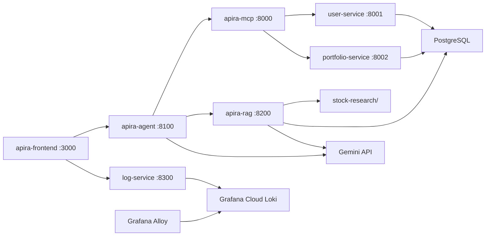

# Apira — System Architecture

Full-stack overview across five repos: [apira](https://github.com/KMeltzer24/apira) (this repo), [apira-frontend](https://github.com/KMeltzer24/apira-frontend), [apira-agent](https://github.com/KMeltzer24/apira-agent), [apira-mcp](https://github.com/KMeltzer24/apira-mcp), and [apira-rag](https://github.com/KMeltzer24/apira-rag).



## Hosting

| Component | Where it runs |
|-----------|---------------|
| **apira-frontend** | Local Mac — Docker at `localhost:3000` |
| **apira-agent** | Local Mac — Docker at `localhost:8100` |
| **apira-mcp** | Local Mac — Docker at `localhost:8000` |
| **apira-rag** | Local Mac — Docker at `localhost:8200` |
| **user-service** | Local Mac — Docker at `localhost:8001` |
| **portfolio-service** | Local Mac — Docker at `localhost:8002` |
| **log-service** | Local Mac — Docker at `localhost:8300` (frontend → Loki) |
| **Grafana Alloy** | Local Mac — ships Docker logs to Loki |
| **Grafana Cloud Loki** | Grafana Cloud Free (hosted) |
| **PostgreSQL** | Local Docker (`docker-compose.local.yml`, pgvector) |
| **Google Gemini** | External API |

## Frontend paths

**Agent Chat** — user prompt → frontend → `POST /chat` on apira-agent. The LangGraph run is sequential, not peer specialists:

```
START → supervisor → portfolio → logged_in → research → save_recommendation → logged_in → END
```

The guest supervisor can only chat or send work to **portfolio** (login + holdings). It is compiled with **no tools**. After portfolio, **logged_in** is the only hop that binds `getPreviousRecommendation` (MCP, python `@tool`, or skills — same name). That is how “GET only after login” is enforced: the guest hop cannot call the tool, and `logged_in` is unreachable until portfolio has run. See [apira-agent: get-previous-recommendation.md](https://github.com/KMeltzer24/apira-agent/blob/main/docs/get-previous-recommendation.md).

Last rec is stored in this repo’s Postgres (`recommendations`, one row per `user_id`). After research, **save_recommendation** upserts via `PUT /recommendation` (a graph hop, not an LLM tool). Research only searches. Login, holdings, and last-rec storage stay tools/APIs, not extra agent processes. The frontend only renders the reply.

**Stock Recommender** — same graph as Agent Chat; frontend selects **local folder** (`searchLocalFolder`) or **vector DB** (`searchVectorDB` / pgvector). Both research tools come from apira-rag; login, portfolio, and last-recommendation **read** come from apira-mcp (`login`, `get_portfolio`, `getPreviousRecommendation`). MCP also exposes `saveRecommendation`; the agent save hop uses the same PUT API without binding that tool on Gemini. See [apira-rag: how-stock-recommender-works.md](https://github.com/KMeltzer24/apira-rag/blob/main/docs/how-stock-recommender-works.md) and [apira-agent: how-the-agent-works.md](https://github.com/KMeltzer24/apira-agent/blob/main/docs/how-the-agent-works.md).

**Portfolio tab** (dashed arrows) — frontend calls backend APIs directly (`POST /login`, then `GET /portfolio?user_id=`). No agent, MCP, or Gemini involved. All tabs share no session state.

**Local stack:** [run-locally.md](run-locally.md) — Postgres and backends on the Mac; Grafana Cloud Loki still works via log-service + Alloy. Vector DB search needs a local ingest; the Recommender **local folder** option does not.

## Observability foundation

Every browser/API request carries an `X-Request-ID`. Services echo and
propagate that ID while writing structured JSON events to browser console or
container stdout. Alloy and `log-service` ship those events to **Grafana Cloud
Loki** so one request is searchable across the agent, MCP tools, backend APIs,
Gemini, and Postgres without logging credentials, prompts, research text, or
embeddings.

This is the logging foundation for the planned production-incident resolution
agent. Dashboards, traces, alerts, and automated remediation are later phases.

See [grafana-cloud.md](grafana-cloud.md), [how-logging-works.md](how-logging-works.md),
and the [logging contract](logging.md).

## Per-repo docs

| Repo | Doc |
|------|-----|
| apira-frontend | [how-the-frontend-works.md](https://github.com/KMeltzer24/apira-frontend/blob/main/docs/how-the-frontend-works.md) |
| apira-agent | [how-the-agent-works.md](https://github.com/KMeltzer24/apira-agent/blob/main/docs/how-the-agent-works.md), [get-previous-recommendation.md](https://github.com/KMeltzer24/apira-agent/blob/main/docs/get-previous-recommendation.md) |
| apira-mcp | [how-mcp-works.md](https://github.com/KMeltzer24/apira-mcp/blob/main/docs/how-mcp-works.md) |
| apira-rag | [README.md](https://github.com/KMeltzer24/apira-rag) |
| apira (backend) | [run-locally.md](run-locally.md) |
| Database layer | [how-the-database-works.md](how-the-database-works.md) |
| How logging works | [how-logging-works.md](how-logging-works.md) |
| Grafana Cloud logs | [grafana-cloud.md](grafana-cloud.md) |
| Logging contract | [logging.md](logging.md) |
| Stock Recommender | [apira-rag: how-stock-recommender-works.md](https://github.com/KMeltzer24/apira-rag/blob/main/docs/how-stock-recommender-works.md) |
| Vector search params | [apira-rag: vector-search-params.md](https://github.com/KMeltzer24/apira-rag/blob/main/docs/vector-search-params.md) |
