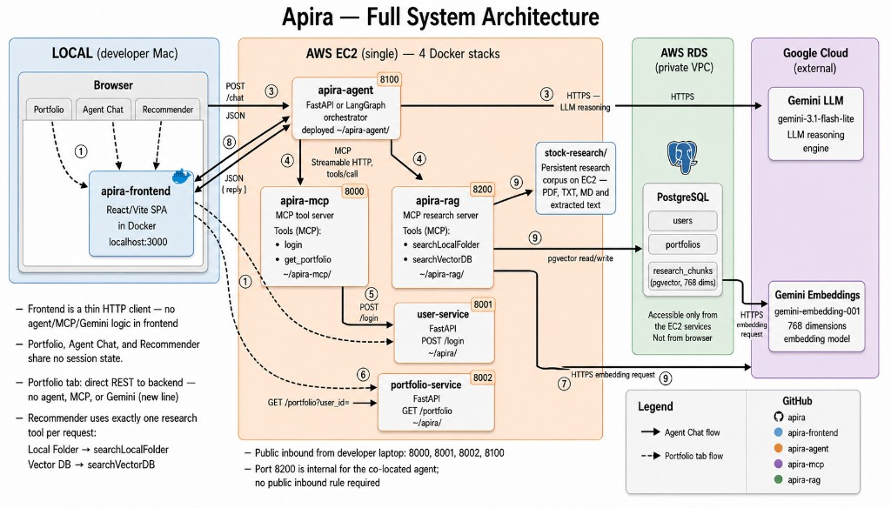

# Apira — System Architecture

Full-stack overview across all four repos: [apira](https://github.com/KMeltzer24/apira) (this repo), [apira-frontend](https://github.com/KMeltzer24/apira-frontend), [apira-agent](https://github.com/KMeltzer24/apira-agent), and [apira-mcp](https://github.com/KMeltzer24/apira-mcp).

## Hosting

| Component | Where it runs |
|-----------|---------------|
| **apira-frontend** | Local Mac — Docker at `localhost:3000` |
| **apira-agent** | AWS EC2 — port `8100` |
| **apira-mcp** | AWS EC2 — port `8000` |
| **user-service** | AWS EC2 — port `8001` |
| **portfolio-service** | AWS EC2 — port `8002` |
| **RDS PostgreSQL** | AWS — private VPC, EC2 only |
| **Google Gemini** | External API |

## Frontend paths

**Agent Chat** (solid arrows) — user prompt → frontend → agent → Gemini → MCP tools → backend APIs → RDS. The frontend only sends `POST /chat` and renders the reply.

**Stock Recommender** — same path as Agent Chat, but the frontend sends a structured prompt to log in, fetch the portfolio, call `searchLocalFolder` (reads `stock-research/` files on EC2), and return hold/add/trim recommendations. See [apira-mcp: how-stock-recommender-works.md](https://github.com/KMeltzer24/apira-mcp/blob/main/docs/how-stock-recommender-works.md).

**Portfolio tab** (dashed arrows) — frontend calls backend APIs directly (`POST /login`, then `GET /portfolio?user_id=`). No agent, MCP, or Gemini involved. All tabs share no session state.

## Per-repo docs

| Repo | Doc |
|------|-----|
| apira-frontend | [how-the-frontend-works.md](https://github.com/KMeltzer24/apira-frontend/blob/main/docs/how-the-frontend-works.md) |
| apira-agent | [how-the-agent-works.md](https://github.com/KMeltzer24/apira-agent/blob/main/docs/how-the-agent-works.md) |
| apira-mcp | [how-mcp-works.md](https://github.com/KMeltzer24/apira-mcp/blob/main/docs/how-mcp-works.md) |
| apira (backend) | [deploy-ec2.md](deploy-ec2.md) |
| Stock Recommender (Phase I) | [apira-mcp: how-stock-recommender-works.md](https://github.com/KMeltzer24/apira-mcp/blob/main/docs/how-stock-recommender-works.md) |
