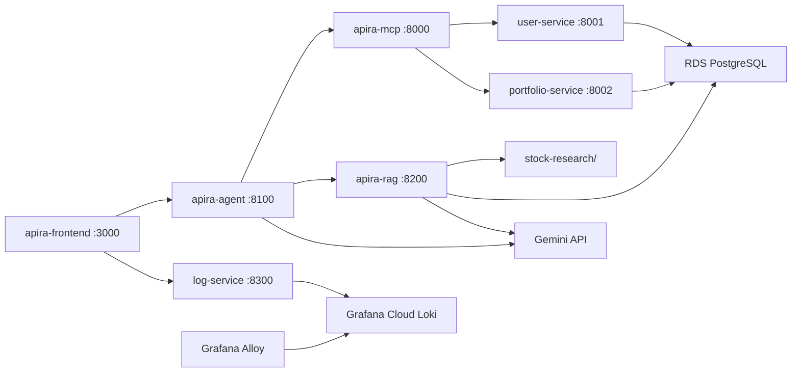

# Apira — System Architecture

Full-stack overview across five repos: [apira](https://github.com/KMeltzer24/apira) (this repo), [apira-frontend](https://github.com/KMeltzer24/apira-frontend), [apira-agent](https://github.com/KMeltzer24/apira-agent), [apira-mcp](https://github.com/KMeltzer24/apira-mcp), and [apira-rag](https://github.com/KMeltzer24/apira-rag).

## Hosting

| Component | Where it runs |
|-----------|---------------|
| **apira-frontend** | Local Mac — Docker at `localhost:3000` |
| **apira-agent** | AWS EC2 — port `8100` |
| **apira-mcp** | AWS EC2 — port `8000` |
| **apira-rag** | AWS EC2 — port `8200` |
| **user-service** | AWS EC2 — port `8001` |
| **portfolio-service** | AWS EC2 — port `8002` |
| **log-service** | AWS EC2 — port `8300` (frontend → Loki) |
| **Grafana Alloy** | AWS EC2 — ships Docker logs to Loki |
| **Grafana Cloud Loki** | Grafana Cloud Free (hosted) |
| **RDS PostgreSQL** | AWS — private VPC, EC2 only |
| **Google Gemini** | External API |

## Frontend paths

**Agent Chat** (solid arrows) — user prompt → frontend → agent → Gemini → MCP tools → backend APIs → RDS. The frontend only sends `POST /chat` and renders the reply.

**Stock Recommender** — same path as Agent Chat; frontend selects **local folder** (`searchLocalFolder`) or **vector DB** (`searchVectorDB` on RDS pgvector). Both research tools come from apira-rag; login and portfolio tools come from apira-mcp. See [apira-rag: how-stock-recommender-works.md](https://github.com/KMeltzer24/apira-rag/blob/main/docs/how-stock-recommender-works.md).

**Portfolio tab** (dashed arrows) — frontend calls backend APIs directly (`POST /login`, then `GET /portfolio?user_id=`). No agent, MCP, or Gemini involved. All tabs share no session state.

## Observability foundation

Every browser/API request carries an `X-Request-ID`. Services echo and
propagate that ID while writing structured JSON events to browser console or
container stdout. Alloy and `log-service` ship those events to **Grafana Cloud
Loki** so one request is searchable across the agent, MCP tools, backend APIs,
Gemini, and RDS without logging credentials, prompts, research text, or
embeddings.

This is the logging foundation for the planned production-incident resolution
agent. Dashboards, traces, alerts, and automated remediation are later phases.

See [grafana-cloud.md](grafana-cloud.md), [how-logging-works.md](how-logging-works.md),
the [logging contract](logging.md), and [how logging works](how-logging-works.md).

## Per-repo docs

| Repo | Doc |
|------|-----|
| apira-frontend | [how-the-frontend-works.md](https://github.com/KMeltzer24/apira-frontend/blob/main/docs/how-the-frontend-works.md) |
| apira-agent | [how-the-agent-works.md](https://github.com/KMeltzer24/apira-agent/blob/main/docs/how-the-agent-works.md) |
| apira-mcp | [how-mcp-works.md](https://github.com/KMeltzer24/apira-mcp/blob/main/docs/how-mcp-works.md) |
| apira-rag | [README.md](https://github.com/KMeltzer24/apira-rag) |
| apira (backend) | [deploy-ec2.md](deploy-ec2.md) |
| Database layer | [how-the-database-works.md](how-the-database-works.md) |
| How logging works | [how-logging-works.md](how-logging-works.md) |
| Grafana Cloud logs | [grafana-cloud.md](grafana-cloud.md) |
| Logging contract | [logging.md](logging.md) |
| Stock Recommender | [apira-rag: how-stock-recommender-works.md](https://github.com/KMeltzer24/apira-rag/blob/main/docs/how-stock-recommender-works.md) |
| pgvector / RDS setup | [apira-rag: setup-pgvector-rds.md](https://github.com/KMeltzer24/apira-rag/blob/main/docs/setup-pgvector-rds.md) |
